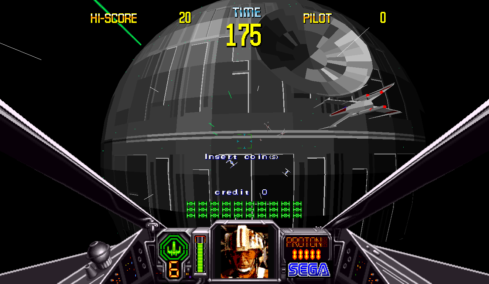
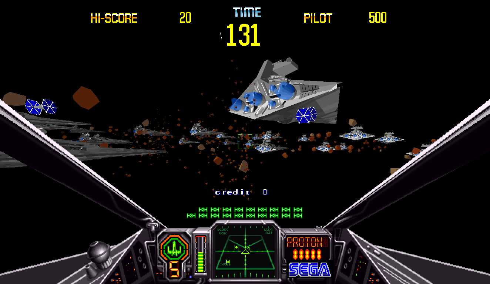
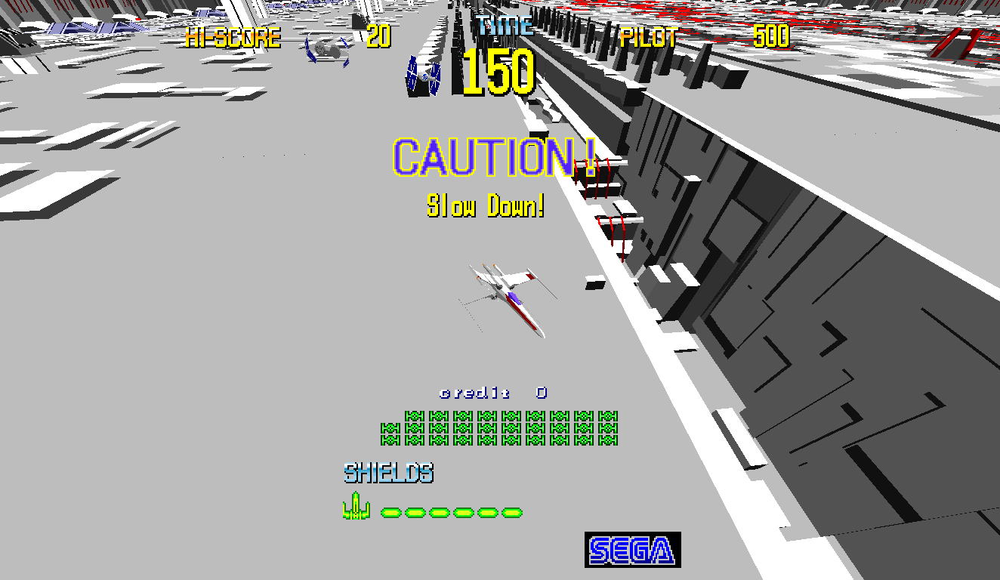
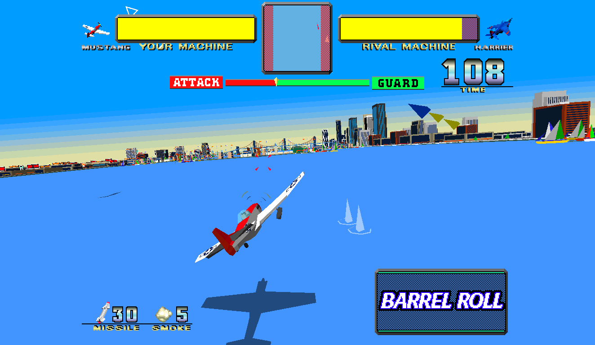
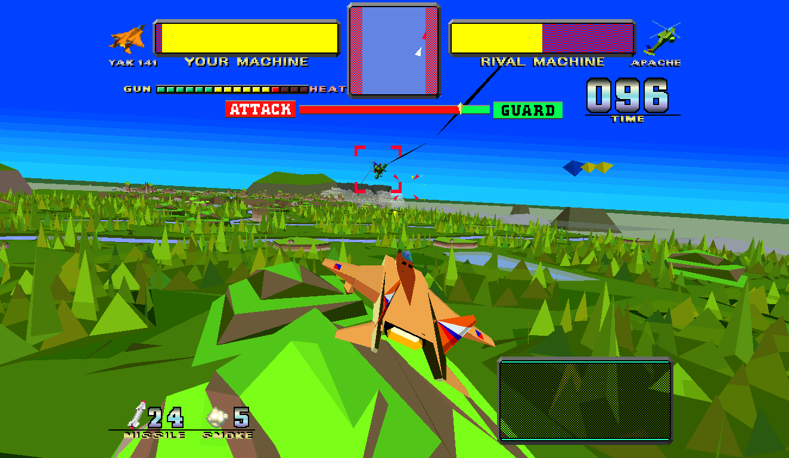
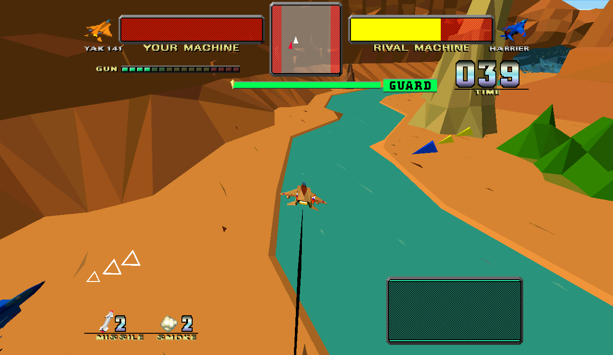

# Model 1 Recomps

<p align="center"><b>SEGA classic arcade games on your computer, with sharper graphics,
widescreen support, and smooth motion at up to 120 FPS.</b></p>

This project forks Mr. Finster's superb [Virtua Fighter recomp](https://github.com/mr-finster/vf1-recomp), refactoring it to support the rest of Sega's Model 1 arcade hardware games library as native desktop runtimes. The Model 1 was used by
multiple games; this repository currently supports Virtua Racing, Star Wars Arcade, and Wing War.

<p align="center">
  <a href="https://github.com/svera/model1-recomps/releases"></a>
  <a href="LICENSE"></a>
  
</p>

<p align="center">
  <a href="#common-features">Features</a> ·
  <a href="#virtua-racing">Virtua Racing</a> ·
  <a href="#star-wars">Star Wars Arcade (1993)</a> ·
  <a href="#wing-war">Wing War (1994)</a>
 </p>

<h2 align="center" id="common-features">Features</h2>

Every game includes:

- Sharper graphics, with widescreen and ultrawide views (up to 32:9) that don't stretch the HUD.
- Original arcade motion or smoother 60 / 120 FPS.
- Full-detail models and full draw distance by default, with options to restore the arcade's own
  LOD and draw distance.
- Keyboard and gamepad support, with customizable controls.
- PC play style without coins, or Arcade play style with the cabinet's coin settings.
- Saved settings and the arcade's own difficulty options.
- Packages for macOS, Windows and Steam Deck / Linux.

Each game's section below lists what is specific to that game.

<h2 align="center" id="virtua-racing">Virtua Racing Recomp</h2>

<p align="center">
  
</p>

> [!IMPORTANT]
> You need your own **`vr.zip`** and **`model1io.zip`** ROM archives. Neither is included.
> Both are needed for steering and pedals to work. This is an unofficial fan project,
> not affiliated with or supported by SEGA.

<p align="center">
  <a href="https://github.com/svera/model1-recomp/releases">Download</a> ·
  <a href="#getting-started">Getting started</a> ·
  <a href="#controls">Controls</a> ·
  <a href="https://github.com/svera/model1-recomp/issues">Report a bug</a>
</p>

### Features

- All three courses, four camera views, and the original arcade racing.
- Local split-screen multiplayer: a second controller can press Start to join; disconnecting it returns to solo play.
- Optional original Live Monitor broadcast above the players or in a spectator window.
- Full draw distance also covers distant cars and the Live Monitor. In the Live Monitor, turning
  LOD on restores Virt McPolygon's original intermittent disappearance caused by the polygon budget.
- Saved high scores.
- Car color, language, and course settings.

### Getting started

1. [Download](https://github.com/svera/model1-recomp/releases) the package for your system and extract it.
2. Keep **`vr.zip`** and **`model1io.zip`** together in the same folder. Leave them zipped.
3. Start the game and select **`vr.zip`** when asked. It remembers your files for next time.
4. Press **1** on the keyboard or **Start** on your gamepad to play.

**Live Monitor:** choose **Display > Live Monitor > Above players** or **Spectator window**.
Watch the original arcade broadcast with Virt McPolygon during solo or two-player games,
above the action or in a window you can move to another display. It follows
**Display > Picture shape** and is off by default. Enabling or disabling it restarts
the game; switching layouts does not. Enabling it may reduce performance.

**macOS:** open **Virtua Racing Recomp.app**. If macOS blocks it, allow it through
**System Settings > Privacy & Security**.

**Windows:** run the included executable. Windows may show a SmartScreen warning for preview builds.

**Steam Deck / Linux:** put both ROM archives in the package's **roms** folder and run
**VirtuaRacing.sh** instead of using a file picker. On Steam Deck, add the launcher as a
Non-Steam Game and set **Start In** to the extracted **VirtuaRacing** folder.

### Controls

| Action | Keyboard | Gamepad |
| --- | --- | --- |
| Steer | Left / Right | Left stick |
| Accelerate | Up | Right trigger |
| Brake | Down | Left trigger |
| Shift up / down | X / Z | A / B (Cross / Circle) |
| Change camera | C | Y / Triangle |
| Start | 1 | Start |
| Insert coin (Arcade mode) | 5 | D-pad Up |
| Open menu | Esc | View / Select |

To see or change your actual controller bindings, open **Esc > Controls > Player 1 >
Pad buttons**. Coins are only needed in Arcade play style.

Under **Controls > Player 1 > Analog axes > Steering curve**, **Arcade** (formerly
Linear) keeps the original response. **Standard** (the default) replaces Exponential with a nonlinear
stick curve, speed-sensitive steering range, and an anti-snap rate limiter.
It retains full steering range at low speed and progressively reduces it at high
speed. Keyboard/D-pad steering uses a more strongly smoothed timed accumulator: holding a direction
ramps toward the speed-limited lock, releasing smoothly returns to center, and
repeated taps build intermediate steering angles. Reversing direction also ramps
through center. Arcade retains instant digital steering. Pedals, course selection
and initials entry are unchanged. Each local player has their own setting; saved Exponential settings
automatically migrate to Standard. Saved Linear settings remain Arcade.

### Useful settings

Open the menu with **Esc** or **View / Select**:

- **Display:** change render scale, antialiasing, screen shape (Fit window, 4:3, 16:10, 16:9, 21:9, or 32:9), background filtering, fullscreen, and frame rate.
- **Display > CRT colours / Brightness / Gamma:** adjust the picture's colours and tones without changing the menus. These require SDL's GPU renderer (Metal on macOS, Vulkan or Direct3D 12 elsewhere); unsupported renderers show “not with this renderer”. Defaults leave the original picture unchanged.
- **Game > Play style:** PC mode starts without coins; Arcade mode uses the cabinet's coin settings.
- **Game:** choose your car color, language, course, and difficulty.
  With two players, Language is directly under Game and applies to both players
  and the Live Monitor. Player submenus keep car color, difficulty and service settings.
- **Sound:** adjust the audio levels.

Higher graphics settings need a faster computer. If play feels slow, lower the render scale
or frame rate.

### Local multiplayer

Virtua Racing starts in solo play and automatically supports a second local player.
The first controller to press Start becomes Player 1 and starts solo play, regardless of
connection order. Start on another controller joins Player 2 from the demo or
course-selection screen. Pressing Start again on Player 1's controller does not add a player.
Joining restarts both players at linked course selection.
If a race is already underway, the join waits until the game returns to
the demo or course-selection screen, without interrupting Player 1's race. If Player 2's controller
disconnects, the game returns to solo play.

### Screenshots

| Big Forest · Beginner | Acropolis · Expert |
| --- | --- |
|  |  |

<h2 align="center" id="star-wars">Star Wars Arcade Recomp</h2>

<p align="center">
  
</p>

> [!IMPORTANT]
> You need your own US **`swa.zip`** and **`model1io.zip`** ROM archives. Neither is included.
> Both are needed for the flight stick and buttons to work. This is an unofficial fan project,
> not affiliated with or supported by SEGA or Lucasfilm.

<p align="center">
  <a href="https://github.com/svera/model1-recomp/releases">Download</a> ·
  <a href="#getting-started-1">Getting started</a> ·
  <a href="#controls-1">Controls</a> ·
  <a href="https://github.com/svera/model1-recomp/issues">Report a bug</a>
</p>

### Features

- The whole arcade game, in both the Rebel Attack and Training missions.
- Two players on one machine: the **Pilot** flies and fires, the **Gunner** aims a second laser.
  Gunner assist lets one player fly with both lasers firing.
- In widescreen, the X-wing cockpit continues out to the screen edges.
- Saved rankings and the arcade's service menu.

Online multiplayer is not supported.

### Getting started

1. [Download](https://github.com/svera/model1-recomp/releases) the package for your system and extract it.
2. Keep **`swa.zip`** and **`model1io.zip`** together in the same folder. Leave them zipped.
3. Start the game and select **`swa.zip`** when asked. It remembers your files for next time.
4. Press **1** on the keyboard or **Start** on your gamepad to play. For two players, pull back
   on the stick while choosing the mode to select PILOT & GUNNER.

**macOS:** open **Star Wars Arcade Recomp.app**. If macOS blocks it, allow it through
**System Settings > Privacy & Security**.

**Windows:** run the included executable. Windows may show a SmartScreen warning for preview builds.

**Steam Deck / Linux:** put both ROM archives in the package's **roms** folder and run
**StarWarsArcade.sh** instead of using a file picker. On Steam Deck, add the launcher as a
Non-Steam Game and set **Start In** to the extracted **StarWarsArcade** folder.

### Controls

| Action | Pilot keys | Gunner keys | Gamepad |
| --- | --- | --- | --- |
| Fly / aim | Arrows | I / J / K / L | Left stick, d-pad |
| Throttle | W faster, S slower | - | Right stick up / down |
| Laser | Z | U | Right trigger |
| Torpedo | X | O | Left trigger |
| Change view | C | - | Y / Triangle |
| Start | 1 | 2 | Start |
| Insert coin (Arcade mode) | 5 | 6 | Left bumper |
| Open menu | Esc | - | View / Select |

To see or change your actual controller bindings, open **Esc > Controls**. Coins are only
needed in Arcade play style. Hold **Tab** to fast-forward, including through attract mode;
**P** pauses and resumes.

### Useful settings

Open the menu with **Esc** or **View / Select**:

- **Display:** change sharpness, screen shape (up to 32:9), fullscreen, and frame rate. 30 FPS shows the
  game as the arcade drew it; 60 and 120 smooth the motion between pictures.
- **Display > LOD:** Off (default) keeps the most detailed models at every distance, including
  the complete Death Star through the attract-mode approach. On uses the arcade's simpler
  distant models.
- **Display > Draw distance:** Full (default) shows the Death Star's surface further out and
  draws the asteroid field's rocks and Star Destroyers before they come into view, so they no
  longer pop in. Arcade keeps the cabinet's original pop-in.
- **Display > Widescreen cockpit:** On (default) continues the cockpit's canopy struts and side
  consoles to the edges of a 16:9 or wider screen, following their lines instead of stretching
  the panel. Off leaves the sides open. Other 2D art, such as the notices and the Rankings,
  keeps its 4:3 proportions; tiled backgrounds on 4:3 screens continue across the selected shape.
- **Game > Play style:** PC mode starts without coins; Arcade mode uses the cabinet's coin settings.
- **Game:** invert flight Y, and the arcade's difficulty (player, enemy, timer) and attract
  sound settings. Changing one of these restarts the game when the menu closes.
- **Game > Service menu:** opens the arcade's own test menu. **9** moves and **F2** selects;
  choose EXIT to return.
- **Cheats > Gunner assist:** in PILOT & GUNNER mode, the Gunner's laser aims at the nearest
  enemy by itself.
- **Sound:** adjust the audio levels.

Higher graphics settings need a faster computer. If play feels slow, lower the render scale
or frame rate.

#### Differences from the arcade

- In 16:9 and wider, the game's view test covers the whole picture, so ships and scenery no
  longer pop in at the old 4:3 edges. Enemies in the extra width act as if on screen (turrets
  and fighters can fire from there), so play differs slightly from 4:3.
- Some pop-in remains because the arcade does it too, such as surface blocks at the sides of
  the screen over the Death Star.
- The black box behind the cockpit's SEGA logo is part of the original artwork.

### Screenshots

| Asteroid field | Death Star surface |
| --- | --- |
|  |  |

<h2 align="center" id="wing-war">Wing War Recomp</h2>

<p align="center">
  
</p>

> [!IMPORTANT]
> You need your own MAME World **`wingwar.zip`** and **`model1io2.zip`** (the Advanced I/O board)
> ROM archives. Neither is included. Both are needed for the flight stick, throttle and buttons
> to work. This is an unofficial fan project, not affiliated with or supported by SEGA.

<p align="center">
  <a href="https://github.com/svera/model1-recomps/releases">Download</a> ·
  <a href="#getting-started-2">Getting started</a> ·
  <a href="#controls-2">Controls</a> ·
  <a href="https://github.com/svera/model1-recomps/issues">Report a bug</a>
</p>

### Features

- The whole single-cabinet arcade game.
- Optional cheats: invincibility and infinite missiles.

Linked-cabinet play is not supported.

### Getting started

1. [Download](https://github.com/svera/model1-recomps/releases) the package for your system and extract it.
2. Keep **`wingwar.zip`** and **`model1io2.zip`** together in the same folder. Leave them zipped.
3. Start the game and select **`wingwar.zip`** when asked. It remembers your files for next time.
4. Press **1** on the keyboard or **Start** on your gamepad to play.

**macOS:** open **Wing War Recomp.app**. If macOS blocks it, allow it through
**System Settings > Privacy & Security**.

**Windows:** run the included executable. Windows may show a SmartScreen warning for preview builds.

**Steam Deck / Linux:** put both ROM archives in the package's **roms** folder and run
**WingWar.sh** instead of using a file picker. On Steam Deck, add the launcher as a
Non-Steam Game and set **Start In** to the extracted **WingWar** folder.

### Controls

| Action | Keyboard | Gamepad |
| --- | --- | --- |
| Yaw | Left / Right | Left stick X or D-pad |
| Pitch | Up / Down | Left stick Y or D-pad |
| Throttle | W / S | Right trigger |
| Machine gun | Z | A / Cross |
| Missile | X | B / Circle |
| Smoke | V | X / Square |
| Change view | C | Y / Triangle |
| Start | 1 | Start |
| Insert coin (Arcade mode) | 5 | D-pad Up |
| Open menu | Esc | View / Select |

To see or change your actual controller bindings, open **Esc > Controls**. Coins are only
needed in Arcade play style. Hold **Tab** to fast-forward; **P** pauses and resumes.

### Useful settings

Open the menu with **Esc** or **View / Select**:

- **Display:** change sharpness, screen shape (up to 32:9), fullscreen, and frame rate. 30 FPS shows the
  game as the arcade drew it; 60 and 120 smooth the motion between pictures.
- **Display > LOD:** Off (default) keeps the highest-detail scenery models at every distance.
  On uses the arcade's simpler distant models.
- **Display > Draw distance:** Full (default) draws distant scenery the arcade left out, without
  changing game timing or collisions. Aircraft and other moving objects keep their original
  visibility. Arcade restores the original scenery limits.
- **Game > Play style:** PC mode (default) skips the startup tests and starts without coins;
  Arcade mode shows the cabinet's boot screen and uses its coin settings.
- **Game:** the arcade's Game Assignments: difficulty (1 easy - 8 hard, default 1), expert-mode
  time and aircraft life. Changing one restarts the game when the menu closes.
- **Game > Service menu:** opens the arcade's own test menu. **9** moves and **F2** selects;
  choose EXIT to return.
- **Cheats:** invincibility (your aircraft takes no damage and doesn't spin when hit) and infinite
  missiles. CPU opponents are unchanged. Both are off by default and reset when the game restarts.
- **Sound:** adjust the audio levels and the arcade's attract-mode sound.

Higher graphics settings need a faster computer. If play feels slow, lower the render scale
or frame rate.

Wing War recompiles your ROM's V60 program to native code at startup; use `--interp` to run on the
Model 1 interpreter instead.

### Screenshots

| Forest dogfight | Canyon river |
| --- | --- |
|  |  |


## Shared Model 1 implementation

The shared runtime models the Model 1 board around its main NEC V60 CPU: the Fujitsu MB86233 geometry
coprocessor (TGP), polygon rasterizer, System 24 tile layers, sound board, and I/O board. The V60 interpreter,
TGP core, and much of the machine implementation are based on MAME. The SDL 3 host supplies the window, input,
audio, saves, and menus.

Menu > **Display > Frame rate** selects **30**, **60**, or **120 FPS**. The 30 FPS arcade option
disables interpolation; 60 and 120 use interpolated pictures. The choice applies immediately and
is saved as `fps` in each game's `settings.ini` (default: 120). Game logic and audio retain their
original timing. The screen's refresh rate and available performance limit the visible frame rate.

The CPU renderer reproduces the arcade's 1x picture. Optional higher render scales, antialiasing, and GPU rendering
are host-side features. On supported systems, the GPU renderer is checked against the CPU renderer and falls back
to the CPU if it detects a difference or error.

In Virtua Racing and Star Wars Arcade, **Display > Free camera** or **F4** enables free camera. Use **W/A/S/D** to move,
**Q/E** to move vertically, the **arrow keys** to look, and **R** to reset. Holding **Shift** moves faster.
Game controls are disabled while the free camera is active.

The recompiler translates the V60 program at startup using an address-only function map and SLJIT. It reads the
game program from the user's ROM set; ROM bytes are not shipped. The developer-only ahead-of-time path emits C++
from analyzed V60 functions and keeps ROM-derived output under `build/`.

## Build and test

Development requires a C++20 compiler, zlib, SDL 3, and FreeType. On macOS, install the latter dependencies with
`brew install sdl3 freetype`. Games have separate build instructions in their guides.
Every game has the same make targets, made from its `src/games/<game>/game.mk`: `<game>`, `<game>-native`,
`<game>-regions`, `<game>-coverage`, `<game>-static`, `<game>-lockstep`, and `<game>-native-lockstep`.

Release packaging is enabled for Virtua Racing, Star Wars Arcade, and Wing War on macOS, Windows,
and Linux. Each platform's `package.sh` builds all enabled games by default.

Useful shared checks:

```sh
make test-model1io-adc
make test-host-gamepads
make test-host-graphics
make test-vr-profile test-vr-gameplay test-vr-tgp-track
make test-wingwar-profile
```

`test-host-graphics` needs a working SDL graphics driver (it uses a hidden window).

## Repository layout

| Path | Contents |
| --- | --- |
| `src/core` | NEC V60 interpreter and Fujitsu MB86233 (TGP) core |
| `src/machine` | Shared Model 1 memory map, interrupts, TGP, rasterizer, tile chip, sound and I/O boards |
| `src/rt` | Recompiler runtime and startup native recompilation |
| `src/host` | SDL 3 host, input, pacing, and RmlUi menu |
| `src/games/<game>` | Game profiles, OM tables, scripted play and host, and game-specific behavior |
| `assets/games/<game>` | VR address map, icon and other artwork |
| `src/gpu` | Metal and SDL_GPU renderers and shaders |
| `tools/recomp` | Ahead-of-time V60-to-C++ recompiler |
| `tools/mac`, `tools/win`, `tools/linux` | Each platform's `package.sh [game ...]`: the downloads, the same for every game |
| `tools/release` | What the platforms share: game settings (`games.sh`), third-party sources (`deps.sh`), `LICENSES.txt` |
| `tools/games/<game>/release` | A game's download settings (`game.sh`), READMEs and launcher |

## Project notes

- [How it was made and validated](docs/HOW-IT-WAS-MADE.md)

## Credits and licence

The project incorporates work from MAME, Musashi, ymfm, SLJIT, the Z80 core, RmlUi, GLM, stb_image, SDL 3, and
FreeType. `tools/release/licenses.sh` gathers the third-party notices for distribution packages.

The project's own code is MIT-licensed: see [LICENSE](LICENSE). Third-party components retain their respective
licences. This project is not affiliated with or endorsed by Sega.
